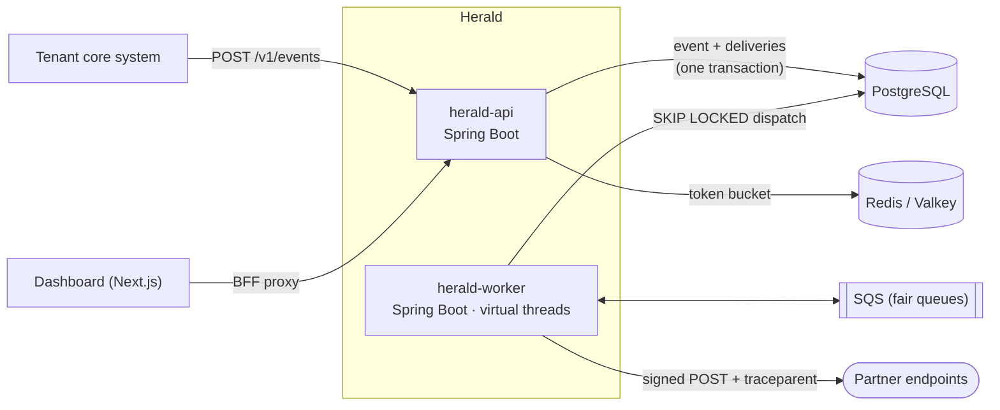

# Herald

**Multi-tenant, reliable event delivery for cloud insurance platforms.**

[](https://github.com/preeeetham/herald/actions/workflows/ci.yml)


P&C insurers run their core systems (policy, claims and billing) as tenants on shared
cloud platforms. Every claim or policy change has to reach a dozen partners: repair
shops, payment gateways, fraud vendors, reinsurers and customer messaging. Herald is the shared
service that makes this boring: **publish an event once; Herald signs it, delivers it,
retries it and records every attempt.** It also guarantees that one tenant's broken
endpoint can never slow down another tenant.

```bash
curl -X POST https://herald.example.com/v1/events \
  -H "Authorization: Bearer $HERALD_API_KEY" \
  -H "Idempotency-Key: claim-204811-created" \
  -H "Content-Type: application/json" \
  -d '{"type":"claim.created","payload":{"claimNumber":"CLM-204811","policyNumber":"POL-55-1932"}}'
```

## Why it exists

Integration work is a top cause of delays in cloud migrations, and it keeps failing in
the same ways: noisy neighbours on shared pipelines, naive retries, events lost
between "saved" and "sent", duplicate payments, unsigned payloads, and no record of
what was actually delivered. The full discovery write-up is in
[docs/01-research.md](docs/01-research.md).

## Highlights

| | |
|---|---|
| **No lost events** | Transactional outbox: the event and its fan-out are committed in one Postgres transaction. There is no broker call in the request path. |
| **Tenant isolation, 4 layers** | Redis token bucket on ingest → fair dispatch (`row_number() OVER (PARTITION BY tenant)`) → SQS fair queues (`MessageGroupId`) → per-tenant bulkheads + per-endpoint circuit breakers. An integration test shows a slow tenant cannot delay others. |
| **Smart retries** | Exponential back-off with jitter over about 11 h, `Retry-After` support, permanent vs. transient classification, a dead-letter state, and single or bulk replay. |
| **At-least-once, duplicate-safe** | Conditional state-transition `UPDATE`s, `SKIP LOCKED` dispatch and a crash-recovery sweeper stop concurrent double delivery. A stable `webhook-id` lets receivers drop the rare retry duplicate. A real READ COMMITTED race found by the test suite is documented in the [design](docs/03-architecture.md#53-deliver). |
| **Security** | [Standard Webhooks](https://www.standardwebhooks.com/) HMAC signatures with zero-downtime secret rotation. AES-256-GCM encrypted secrets bound to tenant and endpoint. SHA-256 hashed API keys. SSRF guard checks resolved DNS, and redirects are never followed. Gitleaks runs on every push. |
| **Observability** | One OpenTelemetry trace from publish → queue → delivery → receiver (trace context is stored with the event). RED metrics per tenant, a Grafana dashboard and a tenant-facing stats API. |
| **Cloud-native** | Stateless services on Java 25 virtual threads. Helm chart with HPA, KEDA (SQS depth), PDBs, probes and non-root read-only containers. Terraform for VPC, EKS, RDS, Valkey, SQS and IRSA. |

## Architecture



Delivery state machine, data model, and every trade-off:
[docs/03-architecture.md](docs/03-architecture.md) · [ADRs](docs/adr).

## Dashboard

Tenant console built with Next.js 16, shadcn/ui and Aceternity UI components. It covers
delivery health KPIs and charts, endpoint management with show-once secrets,
event and delivery explorers, an attempt timeline that shows the back-off between
retries, one-click DLQ replay, and a playground for publishing test events.

## Run it

```bash
scripts/dev-env.sh                                     # generate local secrets (git-ignored)
docker compose -f deploy/docker-compose.yml up --build -d
scripts/demo.sh 40                                     # seed an insurer + realistic events
```

Then open the dashboard at <http://localhost:3000> (sign in with the key printed by
`demo.sh`), Swagger at <http://localhost:8080/swagger-ui.html>, Grafana at <http://localhost:3001>
and Jaeger at <http://localhost:16686>. The demo's endpoints cover every path:
healthy, flaky (retries), slow, and decommissioned (dead-lettered).

Kubernetes: `scripts/kind-up.sh`. AWS: [docs/05-deployment.md](docs/05-deployment.md).

## Project layout

```
herald-core/      framework-free domain: signing, retry policy, crypto, SSRF guard, UUIDv7, Flyway schema
herald-api/       control plane, ingestion, queries, rate limiting, stats (Spring Boot)
herald-worker/    dispatcher, SQS consumers, delivery, isolation, sweeper (Spring Boot)
dashboard/        tenant console (Next.js)
deploy/           docker-compose, Helm chart, Terraform, Grafana/Prometheus, local K8s deps
docs/             research → requirements → design → ADRs → observability → deployment
```

## Engineering process

Built phase by phase, with a written artifact for each SDLC stage:

1. **Discovery**: [problem research](docs/01-research.md)
2. **Requirements**: [PRD](docs/02-requirements.md) with FR/NFR ids and milestones
3. **Design**: [system design](docs/03-architecture.md) and [architecture decision records](docs/adr)
4. **Build**: one branch per feature, merged with `--no-ff`; conventional commits
5. **Test**: 120+ unit and integration tests against real Postgres, Redis and an SQS-compatible broker (Testcontainers), including concurrency, isolation and crash-recovery scenarios
6. **Release & operate**: CI (build, tests, dashboard, secret scan), image releases on tags, a [runbook](docs/05-deployment.md#operational-runbook) and [observability](docs/04-observability.md)

## Tech stack

Java 25 · Spring Boot 4.1 (Web MVC, Security, JDBC, Actuator) · PostgreSQL 17 + Flyway ·
Redis/Valkey · Amazon SQS · Resilience4j · Micrometer + OpenTelemetry · Testcontainers ·
Next.js 16 · TypeScript · Tailwind CSS 4 · Docker · Kubernetes · Helm · KEDA · Terraform ·
GitHub Actions

## License

[MIT](LICENSE)
