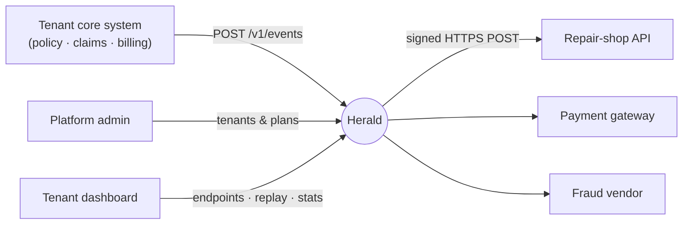
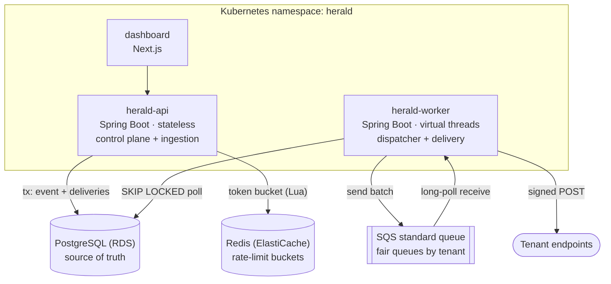
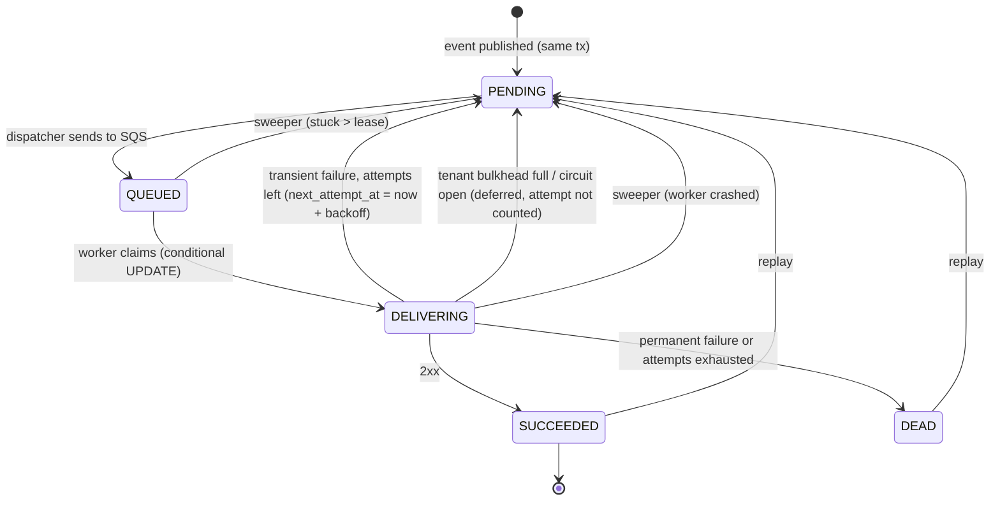

# 03 · System Design

> Status: Approved · Phase: Design · Last updated: 2026-11-25

## 1. Context



## 2. Containers



| Container | Responsibility | Scales on |
|---|---|---|
| `herald-api` | AuthN/Z, tenants, keys, endpoints, ingestion, queries, replay, stats | CPU / RPS (HPA) |
| `herald-worker` | Dispatch due deliveries to SQS, consume, deliver over HTTP, record attempts, schedule retries | SQS queue depth (KEDA) |
| `dashboard` | Tenant console | CPU |
| PostgreSQL | Durable state; transactional outbox | Vertical + read replicas |
| Redis | Token buckets for ingestion rate limits | Vertical |
| SQS | Buffer between dispatch and delivery; tenant fairness | Managed |

## 3. Module layout

```
herald/
├── herald-core     # pure domain: signing, retry policy, ids, crypto, URL guard (no Spring)
├── herald-api      # Spring Boot app: REST, security, persistence, rate limiting, Flyway
├── herald-worker   # Spring Boot app: dispatcher, SQS consumer, HTTP delivery, isolation
├── dashboard       # Next.js + Tailwind console
├── deploy/         # docker-compose, Helm chart, Terraform, Grafana
└── docs/           # research → requirements → design → ADRs → runbook
```

`herald-core` has no framework dependencies so the most critical logic
(signature format, back-off maths, SSRF rules) is unit-tested in isolation.

## 4. Data model

```mermaid
erDiagram
    TENANT ||--o{ API_KEY : has
    TENANT ||--o{ ENDPOINT : owns
    TENANT ||--o{ EVENT : publishes
    EVENT ||--o{ DELIVERY : "fans out to"
    ENDPOINT ||--o{ DELIVERY : receives
    DELIVERY ||--o{ DELIVERY_ATTEMPT : records

    TENANT { uuid id PK; text slug UK; text status; int rate_limit_per_sec; int burst; int max_concurrency }
    API_KEY { uuid id PK; uuid tenant_id FK; text prefix UK; text key_hash; timestamptz revoked_at }
    ENDPOINT { uuid id PK; uuid tenant_id FK; text url; text_arr event_types; bytea secret_ciphertext; text status }
    EVENT { uuid id PK; uuid tenant_id FK; text type; jsonb payload; text idempotency_key }
    DELIVERY { uuid id PK; uuid event_id FK; uuid endpoint_id FK; text status; int attempt_count; timestamptz next_attempt_at }
    DELIVERY_ATTEMPT { uuid id PK; uuid delivery_id FK; int attempt_number; int status_code; int duration_ms; text error }
```

All primary keys are **UUIDv7** — time-ordered, so B-tree inserts stay
append-only and cursor pagination can use the id alone.

## 5. Delivery lifecycle



### 5.1 Publish (transactional outbox)

1. Authenticate API key → tenant.
2. Rate-limit check (Redis token bucket).
3. In **one transaction**: insert `event` (unique on `tenant_id, idempotency_key`),
   find enabled endpoints whose subscriptions match the type, insert one
   `delivery` per endpoint with `status = PENDING, next_attempt_at = now()`.
4. Return `202` with the event id.

There is no "publish to broker" step in the request path, so a crash can never
leave an acknowledged event without deliveries.

### 5.2 Dispatch

Every 250 ms each worker replica runs:

```sql
SELECT id, tenant_id FROM delivery
WHERE id IN (
  SELECT id FROM (
    SELECT id, row_number() OVER (PARTITION BY tenant_id ORDER BY next_attempt_at) AS rn
    FROM delivery WHERE status = 'PENDING' AND next_attempt_at <= now()
  ) t WHERE rn <= :perTenant LIMIT :batch)
FOR UPDATE SKIP LOCKED;
```

- `SKIP LOCKED` lets any number of replicas dispatch without coordination.
- The window function caps how many rows a single tenant can take per tick —
  **fair dispatch** (layer 1 of isolation).
- Messages are sent to SQS *while the row locks are held*, then rows flip to
  `QUEUED` and the transaction commits. If SQS fails the transaction rolls back
  and the rows stay `PENDING`.

### 5.3 Deliver

1. Long-poll SQS (10 messages, 20 s wait). Messages carry `MessageGroupId =
   tenantId` so SQS **fair queues** keep a noisy tenant's backlog from inflating
   others' dwell time (layer 2).
2. Claim: `UPDATE delivery SET status='DELIVERING' WHERE id=? AND (status='QUEUED'
   OR (status='PENDING' AND next_attempt_at <= now()))`. Zero rows → duplicate or
   stale message → ack and drop.
   *Why PENDING too:* SQS can deliver the message before the dispatcher commits.
   Under READ COMMITTED the consumer's snapshot still shows `PENDING`; a plain
   `status='QUEUED'` predicate would filter the row out **without waiting** for
   the dispatcher's lock and strand the delivery until the sweeper runs. Matching
   a due `PENDING` row makes the UPDATE block on the row lock and re-evaluate the
   committed `QUEUED` version. (Found by the integration suite.)
3. Acquire the tenant's **bulkhead** permit (layer 3). Full → defer 1 s.
4. Check the endpoint's **circuit breaker** (layer 4). Open → defer until half-open.
5. Resolve the host, reject private / link-local addresses (SSRF), sign, POST with
   connect timeout 3 s / request timeout 10 s, never follow redirects.
6. Record a `delivery_attempt`; transition per §5 state machine.

### 5.4 Retry policy

Back-off schedule (configurable): `5s, 30s, 2m, 10m, 30m, 1h, 3h, 6h` → 9
attempts over ~10.7 h, each delay with ±20 % jitter to avoid thundering herds.

| Response | Classification |
|---|---|
| `2xx` | Success |
| `408, 409, 425, 429, 5xx`, timeout, connection error | Transient → retry (`Retry-After` honoured, capped) |
| other `4xx`, SSRF rejection, invalid URL | Permanent → `DEAD` |

### 5.5 Recovery

A sweeper returns rows stuck in `QUEUED` / `DELIVERING` longer than the lease
(default 5 min) to `PENDING`. Combined with the conditional claim this gives
**at-least-once** delivery with duplicate suppression on the sender side;
receivers deduplicate using `webhook-id`, which is the stable event id.

## 6. Security

| Concern | Control |
|---|---|
| Tenant auth | `Authorization: Bearer hk_<prefix>_<secret>`; lookup by prefix, constant-time compare of SHA-256 hash |
| Admin auth | Separate admin token (from Secrets Manager / K8s Secret) |
| Tenant isolation in data | Every query is scoped by `tenant_id` taken from the principal, never from the request |
| Payload authenticity | Standard Webhooks HMAC-SHA256 signature over `id.timestamp.body` |
| Secrets at rest | Endpoint secrets encrypted with AES-256-GCM; key injected from KMS-backed secret |
| SSRF | HTTPS-only in prod; DNS resolved and private, loopback, link-local, CGNAT, multicast ranges rejected; no redirects |
| Abuse | Per-tenant token bucket on ingest; payload size cap (256 KB) |

## 7. Observability

- **Metrics** (Micrometer → Prometheus): `herald_events_ingested_total{tenant}`,
  `herald_delivery_attempts_total{tenant,outcome}`, `herald_delivery_latency_seconds`,
  `herald_dispatch_batch_size`, `herald_bulkhead_rejections_total{tenant}`,
  `herald_circuit_state{endpoint}`, `herald_rate_limited_total{tenant}`.
- **Traces** (OpenTelemetry): ingestion span → `traceparent` stored on delivery →
  worker continues the trace across the queue hop.
- **Logs**: structured JSON (ECS), with `trace_id`, `tenant_id`, `delivery_id`.

## 8. Deployment

- Local: `docker compose up` — Postgres, Redis, LocalStack (SQS), API, worker,
  dashboard, Prometheus, Grafana, and a mock receiver.
- Kubernetes: Helm chart with Deployments, Services, HPA (api), KEDA
  `ScaledObject` on SQS depth (worker), PodDisruptionBudgets, probes, and
  IRSA service accounts.
- AWS: Terraform modules for VPC, EKS, RDS Postgres, ElastiCache Redis, SQS +
  DLQ, ECR, Secrets Manager.

## 9. Trade-offs considered

See the ADRs in [`docs/adr`](adr/). Key ones: Postgres outbox + SQS instead of
Kafka (ADR-0002), JDBC over JPA (ADR-0003), and per-replica bulkheads instead of
a distributed semaphore (ADR-0004).
