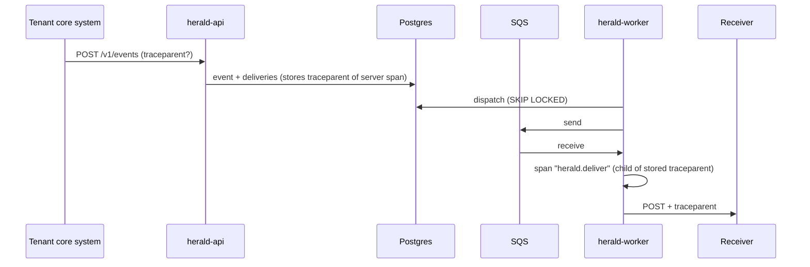

# 04 · Observability

> Status: Implemented · Phase: Build · Last updated: 2026-11-25

Herald follows the RED method (Rate, Errors, Duration) per tenant, plus signals
that show the isolation layers working.

## Metrics (Prometheus, `/actuator/prometheus`)

| Metric | Type | Labels | Meaning |
|---|---|---|---|
| `herald_events_ingested_total` | counter | `tenant` | Events accepted by the API |
| `herald_deliveries_created_total` | counter | `tenant` | Fan-out volume |
| `herald_ratelimit_rejected_total` | counter | `tenant` | Publishes rejected with 429 |
| `herald_delivery_attempts_total` | counter | `tenant`, `outcome` | `succeeded` / `retrying` / `failed` |
| `herald_delivery_duration_seconds` | histogram | `outcome` | Receiver response time |
| `herald_delivery_deferrals_total` | counter | `tenant`, `reason` | `bulkhead`, `circuit_open`, `tenant_suspended` |
| `herald_bulkhead_in_use` | gauge | `tenant` | Permits held on this replica |
| `resilience4j_circuitbreaker_state` | gauge | `name` (endpoint id), `state` | Circuit state per endpoint |
| `herald_dispatch_batch_size` | summary | — | Rows moved to SQS per transaction |
| `herald_sweeper_released_total` | counter | — | Deliveries recovered after a crash |
| `herald_delivery_duplicates_total` | counter | — | Stale / duplicate queue messages dropped |

A Grafana dashboard is provisioned from
[`deploy/observability/grafana/dashboards/herald-overview.json`](../deploy/observability/grafana/dashboards/herald-overview.json).

## Traces (OpenTelemetry → OTLP)

The trace context is persisted with the event, so a single trace links the
publish request, every delivery attempt (even hours later on retry) and the
receiver's own spans. Enable export with `HERALD_TRACING_ENABLED=true` and
`HERALD_OTLP_ENDPOINT`.

## Logs

Set `LOGGING_STRUCTURED_FORMAT_CONSOLE=ecs` for JSON logs. Delivery logs carry
`delivery_id`, `tenant_id`, `endpoint_id`, `attempt`, `outcome`, `status_code`,
`duration_ms` as structured fields, plus `traceId` / `spanId`.

## Tenant-facing stats

`GET /v1/stats?hours=24` returns volume, success rate, latency percentiles, a
gap-filled time series (~24 buckets) and per-endpoint health — the data behind
the dashboard's overview page.
