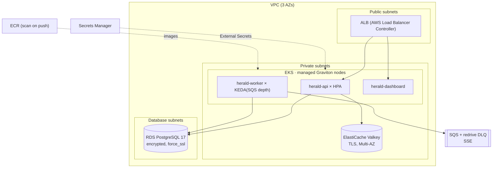

# 05 · Deployment

> Status: Implemented · Phase: Release · Last updated: 2026-11-25

Herald ships as three container images (`herald-api`, `herald-worker`,
`herald-dashboard`) and runs anywhere Kubernetes does. Three paths, from free to
production:

| Path | Use for | Cost | Command |
|---|---|---|---|
| Docker Compose | development, demos | free | `docker compose -f deploy/docker-compose.yml up` |
| kind / k3s | Kubernetes on a laptop or a single VM | free / one VM | `scripts/kind-up.sh` |
| AWS (EKS) | production | see below | Terraform + Helm |

## 1. Docker Compose
See [`deploy/README.md`](../deploy/README.md). Includes Prometheus, Grafana and Jaeger.

## 2. Kubernetes with kind (or k3s)

```bash
scripts/kind-up.sh                         # cluster + images + dependencies + Helm release
kubectl port-forward svc/herald-api 8080:8080
kubectl port-forward svc/herald-dashboard 3000:3000
```

[`deploy/k8s-local/dependencies.yaml`](../deploy/k8s-local/dependencies.yaml)
provides Postgres, Redis, ElasticMQ and a mock receiver inside the cluster.
The same chart and `values-kind.yaml` work on a single **k3s** VM (for example an
Oracle Cloud Always-Free Ampere instance), which is the cheapest way to keep a
public demo running.

## 3. AWS



### Provision

```bash
cd deploy/terraform
cp terraform.tfvars.example terraform.tfvars   # adjust region, sizes
terraform init && terraform apply
$(terraform output -raw configure_kubectl)
```

Terraform creates the VPC, EKS, RDS, Valkey, SQS (+ DLQ), ECR repositories,
the application secret in Secrets Manager and a least-privilege IRSA role
(`sqs:Send/Receive/DeleteMessage` on one queue only).

### Deploy

1. Install cluster add-ons: AWS Load Balancer Controller, External Secrets
   Operator, KEDA, metrics-server.
2. Create an `ExternalSecret` named `herald-secrets` that maps
   `app_secret_arn` (admin token, encryption key) and
   `database_password_secret_arn` (`password` → `HERALD_DB_PASSWORD`).
3. Fill `deploy/helm/herald/values-aws.yaml` from `terraform output` and run:
   ```bash
   helm upgrade --install herald deploy/helm/herald -n herald --create-namespace \
     -f deploy/helm/herald/values-aws.yaml --set image.tag=0.1.0
   ```

### Rough monthly cost (ap-south-1, on-demand, staging sizing)

| Component | Sizing | ≈ USD / month |
|---|---|---|
| EKS control plane | 1 cluster | 73 |
| Worker nodes | 3 × t4g.large | 150 |
| RDS PostgreSQL | db.t4g.medium, single-AZ, 50 GB | 60 |
| ElastiCache Valkey | 2 × cache.t4g.small | 50 |
| NAT gateway | 1 | 35 |
| SQS, ECR, Secrets Manager | low volume | < 5 |
| **Total** | | **≈ 370** |

Production would add Multi-AZ RDS and a NAT gateway per AZ. For a portfolio demo,
the k3s path above costs nothing.

## Release process

1. Merge to `main` (CI: unit + integration tests, dashboard build, secret scan).
2. Tag `vX.Y.Z` → [`release.yml`](../.github/workflows/release.yml) builds
   multi-arch images and pushes them to GHCR.
3. `helm upgrade` with `--set image.tag=X.Y.Z`. Rolling updates use
   `maxUnavailable: 0`; workers drain in-flight deliveries before exit and the
   sweeper recovers anything interrupted.

## Operational runbook

| Symptom | Check | Action |
|---|---|---|
| Rising `DEAD` deliveries for one endpoint | Dashboard → Overview → Endpoint health; `resilience4j_circuitbreaker_state{state="open"}` | Contact the partner; after recovery bulk-replay: `POST /v1/deliveries/replay {"status":"DEAD","endpointId":…}` |
| Queue depth growing | `ApproximateNumberOfMessagesVisible`, KEDA replicas | Raise `worker.keda.maxReplicas`; check DB connection pool saturation |
| `herald_sweeper_released_total` increasing | Worker restarts / OOMKills | Inspect pod events; raise memory limit |
| Tenant reports 429s | `herald_ratelimit_rejected_total{tenant}` | Raise the tenant's plan: `PATCH /admin/v1/tenants/{id}` |
| Messages in the SQS redrive DLQ | Worker error logs for the delivery id | Fix the cause, then redrive; the DB row is recovered by the sweeper regardless |
